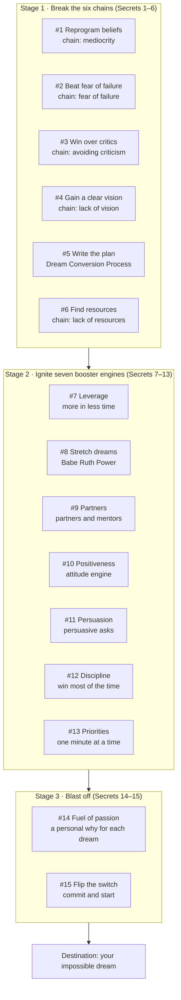

# BRD – Simple Steps to Impossible Dreams Approach

Nov 1, 2026

## Document control

This is draft v0.1, written as a BRD for a "Dream Conversion" goal-achievement program (digital app plus coached workshops) built on Steven K. Scott's method. If the BRD is meant for a different solution, sections 4–9 change; sections 3 and 7 still hold.

| Item | Value |
| --- | --- |
| Document | Business Requirements Document (BRD) |
| Version | 0.1 – Draft |
| Source method | *Simple Steps to Impossible Dreams: The 15 Power Secrets of the World's Most Successful People*, Steven K. Scott (Simon & Schuster, 1998) |
| Business owner | To be confirmed |
| Business analyst | To be confirmed |
| Approvers | Sponsor, Product owner, Head of Learning / Coaching |

| Version | Change | Author |
| --- | --- | --- |
| 0.1 | First draft | BA |

## Implementation status

Status as of Nov 2, 2026. The work is committed and pushed to `main` (latest commit `8d8cdd7`); a production deploy has not been confirmed. Details are in the changelog. VMS is scoped to personal use; see *Personal-use scope* below.

**Work completed**

| Stage | What was done | Requirements |
| --- | --- | --- |
| Phases 1–4 | Today page, journal, assessment, 15 modules, guided plan, milestones, objectives card, plan PDF, reminders, data export and deletion, module editing | BR-01 to BR-15, FR-64 to FR-78 |
| Follow-up | Browser test suite; fixes from the page audit; fear editing; undated steps page | NFR-02 |
| Phase A: checks | Accessibility checks on every open dialog, with three fixes; phone check-in in 3 taps; reminder email delivered over real SMTP in a test; reminder email address and test button on the Dashboard and Account page; production image built and run with Render's limits | NFR-01, NFR-02, FR-18 |
| Phase B: Khmer | Every page, dialog, label, chart and message in Khmer, with Khmer dates; Khmer checked on every page at phone width | NFR-03 |
| Phase C: text editing | Admins change any interface text in English or Khmer, or reset it, without a code change | FR-20 |

**Tests at the latest commit:** 282 backend, 389 frontend unit, and 136 browser checks, all passing locally.

| Mark | Meaning |
| --- | --- |
| ✅ Done | Built and tested |
| 🔷 Built, not fully verified | Built, but one part could not be checked |
| 🔶 Partial | Part is built; the note says what is missing |
| ⛔ Dropped | Removed because VMS is for personal use |
| ➖ Not applicable | Describes a group program, so not tested |

| Group | Done | Built, not fully verified | Partial | Dropped | Not applicable |
| --- | --- | --- | --- | --- | --- |
| Objectives (6) | 6 | 0 | 0 | 0 | 0 |
| Business requirements (15) | 15 | 0 | 0 | 0 | 0 |
| Functional requirements (20) | 15 | 0 | 3 | 2 | 0 |
| Non-functional requirements (10) | 3 | 2 | 3 | 0 | 2 |
| Acceptance criteria (7) | 4 | 0 | 2 | 1 | 0 |

**Still to do:** have a Khmer speaker review the Khmer text, and try a real screen reader. The production image was built and run locally with Render's limits (512MB, 0.5 CPU): it starts, uses about 400MB, and renders a Khmer plan PDF. Before relying on production: confirm the Render deploy and set `MAIL_HOST` for real reminder emails.

## Executive summary

The business needs a repeatable program that takes a person from a vague wish to a written, executed plan, using Scott's 15 Power Secrets as the method. The program has three stages: break six chains that hold people back, ignite seven booster engines that speed progress, then add the passion and commitment that launch the plan.

The core deliverable is Scott's **Dream Conversion Process**: a dream is defined in writing, then turned into a detailed, step-by-step plan. Everything else in the program either removes barriers to that plan or accelerates its execution.

This BRD defines what the business needs (objectives, scope, users, requirements and acceptance criteria). It does not define the technical design.

## Background: the method

Scott's premise is that achieving big dreams is a learnable skill, not luck, IQ, education or money. He calls this skill set the **art of Dream Conversion** ([Simon & Schuster](https://www.simonandschuster.com/books/Simple-Steps-to-Impossible-Dreams/Steven-K-Scott/9780684848693)).

- **Origin.** Scott reports failing at nine jobs in his first six years after college, then building success once he adopted these strategies ([Books n Bobs](https://booksnbobs.com/product/simple-steps-to-impossible-dreams-the-15-power-secrets-of-the-worlds-most-successful-people/)).
- **Two terms.** "Dream Conversion" means all strategies in the book. The "Dream Conversion Process" is the single technique of defining a dream in writing and building a detailed road map to it (book chapter 10).
- **Structure.** Six chains keep people from their dreams: mediocrity, fear of failure, avoiding criticism, lack of vision, lack of knowledge, and lack of resources. Seven booster engines replace them and drive dreams into reality ([ThriftBooks](https://www.thriftbooks.com/w/simple-steps-to-impossible-dreams-the-15-power-secrets-of-the-worlds-most-successful-people_steven-k-scott/284353/)).
- **Tools.** The book uses interactive quizzes, personality-type assessment (e.g. "golden retriever", "beaver") and a personal plan, which this program digitises ([Mentored by a Millionaire session outline](https://pdfcoffee.com/download/steven-scott-mentored-by-a-millionaire-pdf-free.html)).

## Business objectives and success metrics

The program succeeds when participants finish a written Dream Conversion plan and act on it weekly. Targets below are proposed placeholders for the sponsor to confirm.

| ID | Objective | Metric | Proposed target | Status |
| --- | --- | --- | --- | --- |
| BO-01 | Turn wishes into written dreams | % of participants with at least 1 dream written and prioritised | 90% within week 1 | ✅ Done: measured on the Dashboard |
| BO-02 | Produce an executable plan | % with a complete Dream Conversion plan (goals, steps, dates, resources) | 75% within week 4 | ✅ Done: measured on the Dashboard |
| BO-03 | Remove barriers | Average improvement in self-assessment score across the 6 chains | +25% by week 8 | ✅ Done: measured on the Dashboard |
| BO-04 | Sustain execution | % of planned weekly steps completed | 60% or more | ✅ Done: measured on the Dashboard |
| BO-05 | Build support | % with at least 1 partner or mentor recruited | 70% by week 6 | ✅ Done: measured on the Dashboard |
| BO-06 | Deliver results | % reporting a first milestone achieved | 50% by week 12 | ✅ Done: measured on the Dashboard |

## Scope

Phase 1 covers all 15 Power Secrets as guided modules plus the plan builder; integrations and certification wait for a later phase.

**In scope**

- Dream discovery and prioritisation across life areas (career, finance, family, health, relationships, personal growth)
- Self-assessments for the six chains and personality type
- The Dream Conversion Process: written dream, goals, step-by-step plan, dates and resources
- 15 learning modules, one per Power Secret, each with an exercise
- Partner and mentor recruitment tracker
- Daily priority planner and weekly review
- Progress dashboard for participant and coach
- Coach / facilitator workspace for cohorts

**Out of scope (phase 1)**

- Financial, legal, medical or therapy advice
- Payment processing for participants' own ventures
- Integration with HR, LMS or CRM systems
- Formal certification of coaches
- Reproduction of the book's text (modules paraphrase; licensing to be confirmed)

## Stakeholders and user personas

| Stakeholder / persona | Role | Main need |
| --- | --- | --- |
| Sponsor | Funds and approves the program | Measurable participant outcomes, budget control |
| Product owner | Owns backlog and priorities | Clear, testable requirements |
| Coach / facilitator | Runs cohorts, reviews plans | See each participant's progress; give feedback |
| Participant – "Stuck professional" | Employee or individual wanting a career or business change | A clear vision and a plan they believe in |
| Participant – "Aspiring founder" | Wants to start a business with limited money or know-how | Help with know-how, resources and partners |
| Participant – "Life balancer" | Has goals in health, family, relationships | Simple daily routine that fits a busy life |
| Partner / mentor | Invited by a participant | Light-touch view of the dream and how to help |
| Admin | Manages users, content and cohorts | Easy content updates and reporting |

## The approach: three stages, fifteen Power Secrets

The book groups the secrets into chains to break (Part II), booster engines to ignite (Part III) and a launch (Part IV). Secret #5's written plan is the hub every later stage feeds.

## Business requirements by Power Secret

Each Power Secret becomes one module with a business outcome and a required exercise. Secret titles follow the book's published contents ([Powell's](https://www.powells.com/book/simple-steps-to-impossible-dreams-9780684848693), [Barnes & Noble](https://www.barnesandnoble.com/w/simple-steps-to-impossible-dreams-steven-k-scott/1111974937)); the exercises are this program's design. MoSCoW: M = Must, S = Should.

| ID | Stage | Power Secret | Business requirement | Required exercise / output | Priority | Status |
| --- | --- | --- | --- | --- | --- | --- |
| BR-01 | Break chains | #1 Reprogramming Your On-Board Computer | Participants must identify and replace beliefs that keep them at "mediocrity" | Limiting-belief inventory with a replacement statement for each | M | ✅ Done: module form |
| BR-02 | Break chains | #2 Overcoming Fear of Failure | Participants must reframe failure as feedback and plan small tests | Fear list; for each, worst case, likelihood and a low-risk first test | M | ✅ Done: Journal fear log |
| BR-03 | Break chains | #3 Turning critics from foes into friends | Participants must handle criticism by extracting what is useful | Criticism log: source, valid point, response, action | M | ✅ Done: module form; fuller record on Obstacles |
| BR-04 | Break chains | #4 Gaining a Clear and Precise Vision | Participants must define dreams per life area and prioritise them | Dream list by life area, top 3 ranked | M | ✅ Done: dreams with letter rank |
| BR-05 | Break chains | #5 Overcoming Your Lack of Know-How | Participants must convert their top dream into a written plan (Dream Conversion Process) | Plan: dream statement, goals, steps, dates, needed knowledge | M | ✅ Done: Plan page and Vision Map |
| BR-06 | Break chains | #6 Overcoming Your Lack of Resources | Participants must list resources needed and who outside could supply them | Resource gap list with a named source per gap | M | ✅ Done: module form |
| BR-07 | Booster engines | #7 Achieving Infinitely More in a Fraction of the Time | Participants must find ways to multiply effort through others | Leverage map: tasks to delegate, partner or automate | S | ✅ Done: module form |
| BR-08 | Booster engines | #8 Dreaming and Achieving Impossible Dreams ("Babe Ruth Power") | Participants must stretch at least one goal beyond comfort | One "stretch" version of an existing goal | S | ✅ Done: moonshot goal |
| BR-09 | Booster engines | #9 Recruiting the Partners and Mentors of Your Dreams | Participants must recruit people who fill their gaps | Partner/mentor pipeline: name, gap filled, ask made, status | M | ✅ Done: Partners page |
| BR-10 | Booster engines | #10 Igniting the Engine of Positiveness | Participants must track and improve their attitude | Daily attitude check-in and gratitude note | S | ✅ Done: Today check-in; gratitude on Dashboard |
| BR-11 | Booster engines | #11 Effectively and Persuasively Communicating ("Earthquake Persuasiveness") | Participants must prepare persuasive asks for partners, buyers, sponsors | One pitch script, practised and rated | M | ✅ Done: module form, self-rated |
| BR-12 | Booster engines | #12 Acquiring the Discipline of Winning Most of the Time | Participants must build habits that keep promises to themselves | Habit tracker for 3 key disciplines | S | ✅ Done: habits on Today |
| BR-13 | Booster engines | #13 Taking Control of Your Life, One Minute at a Time ("Laser-Accurate Priority Planning") | Participants must plan each day by priority linked to the plan | Daily top-priority list tied to plan steps | M | ✅ Done: Today page |
| BR-14 | Blast off | #14 Acquiring the Fuel of Passion | Participants must connect each dream to a personal "why" | Passion statement per dream | M | ✅ Done: the dream's "why it matters" |
| BR-15 | Blast off | #15 Flipping the Switch | Participants must make a committed decision to start | Signed commitment with start date and first action | M | ✅ Done: signed commitment on the dream |

## Functional requirements

| ID | Area | Requirement | Traces to | Priority | Status |
| --- | --- | --- | --- | --- | --- |
| FR-01 | Onboarding | The system shall register a participant and assign them to a cohort and coach | All | M | 🔶 Partial: registration exists; cohort and coach dropped |
| FR-02 | Assessment | The system shall run a baseline self-assessment scoring each of the 6 chains (1–5) | BR-01–06 | M | ✅ Done: Assessment page (FR-71) |
| FR-03 | Assessment | The system shall run a personality-type quiz and show strengths and blind spots | BR-04, BR-09 | S | ✅ Done: existing Work Style page |
| FR-04 | Dream discovery | The system shall let a participant record dreams per life area and rank them | BR-04 | M | ✅ Done: existing Dreams page |
| FR-05 | Plan builder | The system shall guide the Dream Conversion Process: dream statement → goals → steps → dates → resources → people | BR-05, BR-06 | M | ✅ Done: Plan page checklist linking to existing pages (FR-73) |
| FR-06 | Plan builder | The system shall require every step to have an owner, a due date and a done status | BR-05 | M | ✅ Done: required when saved in full (FR-64); old undated steps and Excel imports are exceptions |
| FR-07 | Modules | The system shall deliver 15 modules in sequence, each unlocking after its exercise is saved | BR-01–15 | M | ✅ Done: journey order, not 1 to 15 (FR-72) |
| FR-08 | Journals | The system shall provide fear, criticism and attitude logs with date stamps | BR-02, BR-03, BR-10 | M | ✅ Done: Journal, Today, criticism module (FR-65) |
| FR-09 | Partners | The system shall track partner/mentor candidates through stages: identified, asked, agreed, active | BR-09 | M | ✅ Done: Agreed status added (FR-66) |
| FR-10 | Partners | The system shall let a participant invite a partner or mentor to view their plan (read-only, opt-in) | BR-09 | S | ⛔ Dropped: personal use |
| FR-11 | Communication | The system shall provide a pitch template and let a coach rate a recorded or written pitch | BR-11 | S | 🔶 Partial: template existed; self-rating replaces coach rating |
| FR-12 | Daily planning | The system shall create a daily priority list pulling due steps from the plan | BR-13 | M | ✅ Done: Today page, also includes tasks (FR-67) |
| FR-13 | Habits | The system shall track up to 3 disciplines with streaks | BR-12 | S | ✅ Done: Today page (FR-68) |
| FR-14 | Commitment | The system shall capture a passion statement and a dated commitment before "launch" | BR-14, BR-15 | M | ✅ Done: dream commitment (FR-69) |
| FR-15 | Review | The system shall prompt a weekly review: steps done, blockers, next week's priorities | BR-05, BR-13 | M | ✅ Done: prompt on Today (FR-70) |
| FR-16 | Dashboard | The system shall show participant and coach dashboards with metrics BO-01 to BO-06 | BO-01–06 | M | 🔶 Partial: personal card done (FR-75); coach view dropped |
| FR-17 | Coaching | The system shall let coaches comment on any exercise and flag at-risk participants (no activity 7 days) | All | M | ⛔ Dropped: personal use |
| FR-18 | Notifications | The system shall send reminders for due steps, weekly review and inactive days | BR-13 | S | ✅ Done: delivered over real SMTP in a test; reminder address and a test-email button on the Dashboard and Account page. Your own mail server still needs `MAIL_HOST` (FR-77) |
| FR-19 | Export | The system shall export a participant's plan as PDF | BR-05 | S | ✅ Done: Plan page; Khmer prints (FR-76) |
| FR-20 | Admin | The system shall let admins edit module content and cohort settings without code changes | All | M | ✅ Done: module text and order (FR-78), and any interface text in English or Khmer from Settings → Account → Edit interface text. Cohort settings dropped: personal use |

## Non-functional requirements

| ID | Category | Requirement | Status |
| --- | --- | --- | --- |
| NFR-01 | Usability | A daily check-in and priority list shall take under 5 minutes on mobile | 🔷 Built, not fully verified: a browser check on a phone screen completes the check-in in 3 taps; not timed with a person |
| NFR-02 | Accessibility | Screens shall meet WCAG 2.1 AA | 🔶 Partial: automated checks pass on all pages and on every kind of open dialog (focus, name, Escape); a real screen reader not tested |
| NFR-03 | Language | UI and content shall support English and Khmer; more languages configurable | 🔷 Built, not fully verified: every page, dialog, label and module in Khmer, with Khmer dates; all pages pass layout and accessibility checks in Khmer. The text is a draft for a Khmer speaker to review. Partner messages you generate stay in English |
| NFR-04 | Privacy | Journals and dreams are private by default; sharing is opt-in per item | ✅ Done: data stays private to each account; no sharing exists |
| NFR-05 | Security | Personal data encrypted in transit and at rest; role-based access (participant, coach, partner, admin) | 🔶 Partial: role-based access exists, partner and coach roles dropped; encryption not verified |
| NFR-06 | Availability | 99.5% monthly uptime | ➖ Not applicable: not tested, group program target |
| NFR-07 | Performance | Pages load in under 3 seconds on a 4G connection | 🔶 Partial: about 2.4s to page heading on simulated 4G, locally only |
| NFR-08 | Scalability | Support 5,000 active participants and 100 concurrent cohorts in phase 1 | ➖ Not applicable: not tested, group program target |
| NFR-09 | Data retention | Participant can export or delete all their data on request | ✅ Done: Account page |
| NFR-10 | Content IP | Module text is original or licensed; no verbatim book reproduction without rights | ✅ Done: module text is original |

## Participant journey (12-week cohort)

The journey runs in a straight line for 4 weeks, then loops weekly until milestones are hit. Week numbers are a proposed schedule.

1. **Week 0 – Onboard.** Register, join cohort, take the 6-chain and personality assessments (FR-01–03).
2. **Week 1 – Dream.** Record dreams by life area; rank top 3 (Secret #4).
3. **Weeks 1–2 – Break chains.** Complete Secrets #1, #2, #3: beliefs, fears, criticism.
4. **Weeks 2–3 – Plan.** Run the Dream Conversion Process on the top dream; map resource gaps (Secrets #5, #6).
5. **Week 4 – Commit.** Write passion statement and sign commitment with start date (Secrets #14, #15). Coach approves plan.
6. **Weeks 4–8 – Ignite engines.** One engine module per week (Secrets #7–#13): leverage, stretch goal, partners, positiveness, persuasion, discipline, daily priority planning.
7. **Weekly loop.** Daily priority list → act → log → weekly review → adjust plan. Coach flags at-risk participants.
8. **Week 12 – Review.** Re-take the 6-chain assessment, report milestone, set next dream.

## Assumptions, constraints, dependencies and risks

**Assumptions**

- Participants commit about 2 hours a week plus 5 minutes a day.
- Each cohort has a trained coach at a ratio of about 1:20.
- The 15 Power Secrets are used as a framework; module content is written in-house.

**Constraints**

- Phase 1 budget and launch date to be set by the sponsor.
- Copyright: the book's text cannot be reproduced without a licence from the rights holder.

**Dependencies**

- Coach recruitment and training before cohort 1.
- Content team to write 15 modules and exercises.

| Risk | Impact | Mitigation |
| --- | --- | --- |
| Participants drop out after week 2 | BO-04 and BO-06 missed | Short daily tasks, coach nudges, peer cohort |
| Plans stay vague | No measurable progress | FR-06 forces owner, date and status on every step; coach approval at week 4 |
| Content seen as generic motivation | Low engagement | Tie every module to an exercise that changes the plan |
| Licensing dispute over book material | Legal and brand risk | Paraphrase only; seek licence if branding uses the book name |
| Sensitive personal data exposed | Trust loss | NFR-04, NFR-05; privacy review before launch |

## Acceptance criteria and sign-off

Phase 1 is accepted when a pilot cohort of at least 20 participants completes weeks 0–4 and every Must requirement passes UAT.

**Status:** ⛔ the pilot cohort does not apply to personal use. Testing so far is automated tests and a scripted browser run, not user acceptance testing.

| ID | Acceptance criterion | Verifies | Status |
| --- | --- | --- | --- |
| AC-01 | A participant can go from registration to a saved, coach-approved Dream Conversion plan without help | FR-01–07, BR-05 | 🔶 Partial: flow works; coach approval dropped; "without help" not tested with a person |
| AC-02 | Every plan step has owner, due date and status; saving fails otherwise | FR-06 | ✅ Done: tested; same exceptions as FR-06 |
| AC-03 | Modules 1–15 unlock in order and each saves its exercise output | FR-07, BR-01–15 | ✅ Done: tested in journey order, as amended below |
| AC-04 | Daily priority list shows only steps due that day or overdue | FR-12 | ✅ Done: tested; also shows tasks, leaves out paused work |
| AC-05 | Coach dashboard flags a participant after 7 days of no activity | FR-17 | ⛔ Dropped: personal use |
| AC-06 | Dashboards report BO-01 to BO-06 correctly against test data | FR-16 | 🔶 Partial: personal metrics tested; coach dashboard dropped |
| AC-07 | Private items are never visible to partners unless shared | NFR-04 | ✅ Done: partners have no access at all |

**Open questions**

- [x] Is the solution a digital app, a workshop series, or both? **Digital app for personal use.**
- [x] Who are the sponsor and product owner? **Not needed for personal use.**
- [x] Will the program use the book's name, requiring a licence? **No. The product does not use it. Whether a licence is ever needed is a legal question, not checked here.**
- [x] Confirm the target numbers in section 4. **Replaced by personal targets: the 25% and 60% defaults can be changed in settings.**

| Role | Name | Decision | Date |
| --- | --- | --- | --- |
| Sponsor | | | |
| Product owner | | | |
| Head of Coaching | | | |

## Personal-use scope (decided Nov 1, 2026)

VMS is used for personal tracking, not as a group program. This section overrides
the rest of this document where they differ.

**Dropped:** cohorts, coach and partner logins, role-based sharing, the coach
dashboard, coach comments and at-risk flags, and coach plan approval (FR-01 cohort
assignment, FR-10, FR-11 rating, FR-16 coach view, FR-17, and the coach parts of
AC-01, AC-05 and AC-06). A coach is only a name the user records. One user can
never see another user's data.

**Decisions:** modules run in journey order by default (4, 1, 2, 3, 5, 6, 14, 15,
then 7 to 13), which replaces "in order" in AC-03. Module locks only block later
modules, never existing features. Existing steps take the account name as owner.

**Numbering:** earlier BRDs already use FR-01 and BR-01, so V8 work continues from
FR-64 and BR-53, with migrations from V39.

| Phase | Work | Source | Internal ID | Status |
| --- | --- | --- | --- | --- |
| 1 | Step owner and date required | FR-06 | FR-64 | Done |
| 1 | Fear and attitude logs | FR-08 | FR-65 | Done |
| 1 | Partner stages, adds Agreed | FR-09 | FR-66 | Done |
| 1 | Daily priority list | FR-12 | FR-67 | Done |
| 1 | Habit streaks | FR-13 | FR-68 | Done |
| 1 | Passion statement and commitment | FR-14 | FR-69 | Done |
| 1 | Weekly review prompt | FR-15 | FR-70 | Done |
| 2 | Six-chain assessment and retake | FR-02 | FR-71 | Done |
| 2 | 15 modules unlocked in order | FR-07, BR-01 to BR-15 | FR-72 | Done |
| 2 | Guided plan | FR-05 | FR-73 | Done |
| 2 | Milestones | BO-06 | FR-74 | Done |
| 3 | Personal BO-01 to BO-06 card | FR-16 | FR-75 | Done |
| 3 | Plan PDF | FR-19 | FR-76 | Done |
| 3 | Optional daily reminder | FR-18 | FR-77 | Done |
| 3 | Data export and account deletion | NFR-09 | NFR-09 | Done |
| 4 | Khmer interface and module text | NFR-03 | NFR-03 | Built; Khmer needs a speaker's review |
| 4 | Admin editing of module text and order | FR-20 | FR-78 | Done |
| 4 | Admin editing of interface text | FR-20 | FR-20 | Done |
| 4 | Accessibility checks | NFR-02 | NFR-02 | Automated checks pass on all pages and open dialogs; real screen reader not tested |
| 4 | Performance check | NFR-07 | NFR-07 | Under 3s to page heading on simulated 4G, locally only |

**Module exercises:** where the app already records an exercise's output, that data
proves the module, so nothing is typed twice. BR-11's rating is a self-rating, and
module titles are original rather than the book's. FR-03's personality quiz was
already met by Work Style.

**Not applicable to personal use:** NFR-06 (99.5% uptime) and NFR-08 (5,000 participants)
were not tested, because they describe a group program.

**Business rules added:** BR-53, a step needs an owner and a target date when saved
in full. BR-54, at most three active habits. BR-55, a commitment needs a written
reason on the dream first. BR-56, a module opens only when every earlier module is
done, and a lock never blocks another feature. BR-57, a plan is ready once its
statement, goals, steps and dates are in place; resources and people do not hold it
back. BR-58, reminders stay off until the user turns them on, and at most one
is sent per local day. BR-59, deleting an account needs the password and is the one
permanent delete with no archive step. The BO targets become personal: each is "done
or not", without the group percentages and week deadlines. BR-60, module text and
order are shared by every account, so only an ADMIN can change them.

## Sources

- [Simon & Schuster – book page and excerpt](https://www.simonandschuster.com/books/Simple-Steps-to-Impossible-Dreams/Steven-K-Scott/9780684848693)
- [Powell's – table of contents](https://www.powells.com/book/simple-steps-to-impossible-dreams-9780684848693)
- [Barnes & Noble – table of contents](https://www.barnesandnoble.com/w/simple-steps-to-impossible-dreams-steven-k-scott/1111974937)
- [ThriftBooks – overview and reader summary](https://www.thriftbooks.com/w/simple-steps-to-impossible-dreams-the-15-power-secrets-of-the-worlds-most-successful-people_steven-k-scott/284353/)
- [Books n Bobs – description](https://booksnbobs.com/product/simple-steps-to-impossible-dreams-the-15-power-secrets-of-the-worlds-most-successful-people/)
