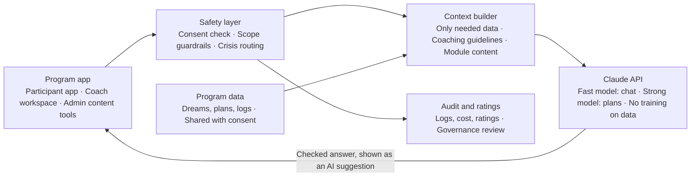

# BRD – Dream Conversion Program with Claude AI Integration

Nov 2, 2026

## Document control

This is draft 9.0.0 (formerly v0.2). It keeps every requirement in BRD v0.1 (Simple Steps to Impossible Dreams) and adds Claude AI as an in-app coaching assistant that suggests, recommends, drafts goals and plans, and helps coaches. Where this BRD is silent, v0.1 still applies.

| Item | Value |
| --- | --- |
| Document | Business Requirements Document (BRD) – AI integration addendum and consolidated v0.2 |
| Version | 9.0.0 – Draft (system version 9 implements it; see `CHANGELOG.md`) |
| Parent document | BRD – Simple Steps to Impossible Dreams Approach, v0.1 (1 Nov 2026) |
| Source method | *Simple Steps to Impossible Dreams: The 15 Power Secrets of the World's Most Successful People*, Steven K. Scott (Simon & Schuster, 1998) |
| AI provider | Anthropic – Claude models via the Claude API |
| Business owner | To be confirmed |
| Business analyst | To be confirmed |
| Approvers | Sponsor, Product owner, Head of Learning / Coaching, Data Protection Officer, AI governance lead |

| Version | Change | Author |
| --- | --- | --- |
| 9.0.0 | Review decisions of 2 Nov 2026 recorded (see *Decisions*); coaches and cohorts return; one AI consent covers dreams, plans and journals; $20/month AI budget; crisis shows help lines; ID mapping to the app; added AI-FR-25 and AI-FR-26; AI-FR-23 limited to content | BA |
| 0.2 | Added Claude AI integration: AI capabilities per Power Secret, AI functional and responsible-AI requirements, updated journey, risks and acceptance criteria | BA |
| 0.1 | First draft | BA |

## Decisions (2 Nov 2026)

Answers from the review of this draft. Where they change a requirement, the requirement below has been updated.

| # | Question | Decision | Effect |
| --- | --- | --- | --- |
| D-1 | Personal use, or coaches and cohorts? | Bring back coaches and cohorts | Reverses the V8 personal-use scope. The v0.1 coach and cohort features dropped in V8 must be built first (see *Prerequisites from v0.1*). |
| D-2 | What may be sent to Claude? | Dreams, plans and all journals (fears, criticism, attitude) | One AI consent covers all of it (AI-NFR-03); partner contact details still stay out unless needed (AI-NFR-04). |
| D-3 | Monthly AI budget | $20 per month in total, for all participants (confirmed) | BO-12 and AI-NFR-15 use this as the hard monthly cap. |
| D-4 | Khmer review of AI answers | Yes, a Khmer speaker will review | AC-15 stands; the reviewer is a named dependency. |
| D-5 | Crisis response | Show help lines and alert the participant's coach (confirmed) | AI-NFR-09 shows local and international help lines and alerts the coach per the safeguarding policy. |
| D-6 | Coach access to data | A coach may read their own cohort's participants' data, and nothing else (confirmed) | Exception to the rule that no user sees another user's data; enforced on the server (AI-NFR-07, AC-13). |
| D-7 | How participants join a cohort | With a join code from the admin, at registration or later in Account settings; an admin can move people between cohorts | Implements FR-01's cohort assignment. |
| D-8 | What a coach sees | Dreams, goals, steps, tasks, progress and activity; fear and attitude journals only when the participant shares them | Keeps v0.1 NFR-04 (journals private by default) within D-6. |

### Prerequisites from v0.1

V8 shipped these v0.1 requirements only in part, because it was scoped to personal use. Coaching AI (AI-FR-18 to AI-FR-21) cannot be built until they exist.

| v0.1 ID | Needed for V9 | V8 state | V9 status |
| --- | --- | --- | --- |
| FR-01 | Cohort and coach assignment at registration | Registration only | ✅ Done (Phase 1): join code at registration or in Account settings (D-7) |
| FR-10 | Partner or mentor read-only view (opt-in) | Not built | ✅ Done (Phase 2): per-dream share links that end or can be stopped; public read-only page with no journals, tasks or contact details |
| FR-11 | Coach rating of a pitch | Self-rating only | ✅ Done (Phase 2): coach rates the module 11 pitch 1 to 5 with feedback; the participant sees it on the module page |
| FR-16 | Coach dashboard | Personal card only | ✅ Done (Phase 1): Coaching page, each participant's six objectives and last activity |
| FR-17 | Coach comments and at-risk flag | Not built | ✅ Done (Phase 1): comments on a participant's plan, shown on their Today page; at risk after 7 days with no activity (AC-05) |
| FR-20 | Cohort settings | Module and interface text only | ✅ Done (Phase 1): Cohorts page for name, coach, start date, join code, members and archiving |

This also changes a standing project rule: no user could see another user's data. A coach now has read-only access to the participants of the active cohorts they coach, and nothing else (D-6, AI-NFR-07); `CLAUDE.md` rule 14 records the exception.

### Implementation status

| Phase | Scope | Status |
| --- | --- | --- |
| 1 | Cohorts and coaches (FR-01, FR-16, FR-17, FR-20) | Built and tested locally, 3 Nov 2026 |
| 2 | Partner view and coach pitch rating (FR-10, FR-11) | Built and tested locally, 3 Nov 2026 |
| 3 | AI foundation: backend Claude service, consent, $20 cap, fallback, safety, logging, chat history | Built and tested locally (Claude mocked in tests), 3 Nov 2026: AI settings page with encrypted key (AI-FR-24 in part), consent (AI-NFR-03), basic Dream Coach chat with history, rating and deletion (AI-FR-05, AI-FR-06, AI-FR-25), budget cap, 80% warning and daily limit (AI-NFR-15), fallback (AI-NFR-02), crisis help lines and coach alerts (AI-NFR-09), usage log without text (AI-NFR-14). Not yet tried against the live API |
| 4 | Dream Coach (AI-FR-01 to AI-FR-06, AI-NFR-01) | Built and tested locally (Claude mocked in tests), 3 Nov 2026: on every screen with three quick questions per page, context from the dream, module, plan, tasks and journals on screen, streamed replies, "Based on ..." reasons, copy and rating. Not yet tried against the live API |
| 5 | Goal and plan builder (AI-FR-07 to AI-FR-11) | Built and tested locally (Claude mocked in tests), 3 Nov 2026: plan assistant on each dream (SMART goals, stretch goal, steps with owner, date, resources and people, plan check whose rule-based half works without AI), steps that keep slipping on Today, and a Resources and people field on steps. Suggestions are edited and added by the participant; the AI never saves (AI-FR-04, AC-09) |
| 6 | Daily use (AI-FR-12 to AI-FR-17) | Built and tested locally (Claude mocked in tests), 3 Nov 2026: next best step on Today for the time available, resource ideas per goal (all "check before use", no links, until AI-FR-26), weekly review draft, AI encouragement in reminder emails (admin switch, off by default), pitch coach on module 11 and Communication, outreach drafts on Communication |
| 7 | Module help (AIB-01 to AIB-15) and assessment explanation (FR-02 change) | Built and tested locally (Claude mocked in tests), 3 Nov 2026: Module helper on every module (questions one at a time, an example, a draft that fills the form, feedback), each module with its own AIB focus; drafts never save or unlock (AC-09); "Explain my result" on the assessment names one module to focus on |
| 8 | Coach co-pilot (AI-FR-18 to AI-FR-21) | Built and tested locally (Claude mocked in tests), 3 Nov 2026: weekly AI summary per participant (progress, mood only when journals are shared, risks, one action), kept for the week and rated accurate or not (AC-16); risk signals with reasons on the coach list (rule-based, explained by the summary); feedback drafts the coach edits and sends; cohort summary from participants who gave AI consent, without names. Needs the participant's AI consent; does not use the coach's daily limit |
| 9 | Admin AI (AI-FR-22 to AI-FR-24, AI-FR-26) | Not started |

### How v0.1 IDs map to the app

The app already used FR-01 to FR-63 for earlier work, so V8 gave the v0.1 requirements new IDs. In this document, FR-xx means the v0.1 requirement.

| v0.1 | App | v0.1 | App |
| --- | --- | --- | --- |
| FR-02 | FR-71 | FR-12 | FR-67 |
| FR-05 | FR-73 | FR-13 | FR-68 |
| FR-06 | FR-64 | FR-14 | FR-69 |
| FR-07 | FR-72 | FR-15 | FR-70 |
| FR-08 | FR-65 | FR-16 | FR-75 (personal card) |
| FR-09 | FR-66 | FR-18 | FR-77 |
| FR-19 | FR-76 | FR-20 | FR-78 and interface text editing |

New V9 requirements keep the AI-FR, AI-NFR and AIB prefixes, so they do not collide with app IDs.

## Executive summary

The business needs Claude AI inside the Dream Conversion program so every participant gets a personal guide 24/7, not only when a coach is free. Claude turns vague wishes into clear goals, drafts the step-by-step plan, suggests fixes for blockers and recommends next actions; the participant and coach always decide.

In v0.1 participants complete 15 exercises mostly alone, and coaches at a 1:20 ratio review everything by hand. The main risks were vague plans and drop-out after week 2. Claude addresses both:

- **For participants** – a "Dream Coach" assistant that asks questions, drafts SMART goals, builds plan steps with dates and resources, suggests partners and pitch wording, and gives a daily nudge.
- **For coaches** – AI summaries of each participant, risk alerts with reasons, and draft feedback the coach edits before sending. Target coach ratio rises from 1:20 to 1:40 without lowering quality.
- **For admins** – AI help to draft and translate module content (English and Khmer), always reviewed by a human before publishing.

Claude is an assistant, not an authority. It never gives financial, legal, medical or therapy advice, never shares private data without consent, and every AI output is editable and labelled as AI-suggested.

This BRD defines business needs only. Technical design (prompts, model choice, architecture details) goes in a separate solution design.

## Background and AI vision

Scott's method says big dreams are reached through a learnable skill he calls Dream Conversion: write the dream, then build a detailed road map to it. The hardest parts for participants are the blank page (what is my dream, what are the steps?) and keeping going. Claude is well suited to both: it is strong at structured questioning, drafting, summarising and reasoning over a participant's own data.

**Vision:** every participant has a patient, always-available Dream Coach that knows their dreams, plan and progress, and helps them take the next small step today.

### Gaps in v0.1 that AI closes

| v0.1 gap | Effect | How Claude helps |
| --- | --- | --- |
| Blank-page exercises | Slow start, vague answers | Guided questions and draft answers the participant edits |
| Plans stay vague (v0.1 risk) | No measurable progress | Rewrites goals as SMART, breaks them into dated steps, flags missing owner, date or resource |
| Drop-out after week 2 (v0.1 risk) | BO-04, BO-06 missed | Personal nudges, small next-step suggestions, encouragement tied to the participant's own "why" |
| Coach time limited (1:20) | Late feedback | Weekly AI summary and draft feedback per participant |
| Content in two languages | High authoring cost | AI first drafts and Khmer translation, human-reviewed |

### AI design principles

1. **Human decides.** Claude suggests; the participant accepts, edits or rejects. Coaches approve plans (v0.1 week 4 gate stays).
2. **Grounded in the method.** Claude's guidance follows the 15 Power Secrets framework as written in the program's own module content, not the book text.
3. **Grounded in the participant's data.** Suggestions use the participant's own dreams, plan, logs and assessments, only with their consent.
4. **Transparent.** Every AI output is labelled "AI suggestion" and shows why (e.g. "based on your fear log").
5. **Safe and in scope.** No financial, legal, medical or therapy advice; crisis language routes to human help.
6. **Private by default.** v0.1 NFR-04 still holds; AI never reveals one person's data to another.
7. **Measured.** AI quality and usefulness are tracked like any other business outcome.

## Business objectives and success metrics

The v0.1 objectives stay; AI should lift each one, and new AI objectives make sure the assistant is useful, trusted and affordable. All targets are proposed placeholders for the sponsor to confirm.

### v0.1 objectives with AI-raised targets

| ID | Objective | Metric | v0.1 target | Target with AI |
| --- | --- | --- | --- | --- |
| BO-01 | Turn wishes into written dreams | % with at least 1 dream written and prioritised | 90% within week 1 | 95% within week 1 |
| BO-02 | Produce an executable plan | % with a complete Dream Conversion plan | 75% within week 4 | 85% within week 3 |
| BO-03 | Remove barriers | Average improvement across the 6-chain self-assessment | +25% by week 8 | +30% by week 8 |
| BO-04 | Sustain execution | % of planned weekly steps completed | 60% or more | 70% or more |
| BO-05 | Build support | % with at least 1 partner or mentor recruited | 70% by week 6 | 75% by week 6 |
| BO-06 | Deliver results | % reporting a first milestone achieved | 50% by week 12 | 60% by week 12 |

### New AI objectives

| ID | Objective | Metric | Proposed target |
| --- | --- | --- | --- |
| BO-07 | AI is used | % of active participants using the Dream Coach at least weekly | 70% |
| BO-08 | AI suggestions are useful | % of AI suggestions accepted (as-is or edited) | 50% or more |
| BO-09 | AI is trusted | Average helpfulness rating of AI responses (1–5) | 4.0 or more |
| BO-10 | Coaches save time | Coach minutes per participant per week | –40% vs v0.1 pilot; ratio up to 1:40 |
| BO-11 | AI is safe | Unsafe or out-of-scope responses found in monthly review | 0 critical; under 1% minor |
| BO-12 | AI is affordable | Total AI cost per month | $20 or less (D-3) |

## Scope

Phase 1 adds Claude to the participant app, coach workspace and admin content tools; everything in v0.1 phase 1 scope stays in scope.

**In scope (added by this BRD)**

- Dream Coach chat assistant inside the app, aware of the participant's current module and plan
- AI help in all 15 module exercises (questions, examples, draft answers, feedback)
- AI goal builder: turn a dream into SMART goals and a stretch goal
- AI plan builder: break goals into dated steps, resources and people; check plan quality
- AI recommendations: next best step, resources, partner types, habits
- AI daily priority suggestions and weekly review summary
- AI pitch coach (practice and feedback for Secret #11)
- Coach co-pilot: participant summaries, risk reasons, draft feedback
- Admin content assistant: draft modules, quizzes and Khmer translation for human review
- AI safety, privacy, consent, logging and quality monitoring

**Out of scope (phase 1)**

- All v0.1 out-of-scope items (financial, legal, medical or therapy advice; payments; HR/LMS/CRM integration; coach certification; book text reproduction)
- AI taking actions outside the app (sending emails, contacting partners, booking)
- Voice conversations with AI (candidate for phase 2)
- Fully automated plan approval without a coach
- Training or fine-tuning a model on participant data
- AI scoring that affects any employment or HR decision

## Stakeholders, personas and AI touchpoints

Each v0.1 persona keeps its needs; the table adds what Claude does for each. Two new stakeholders join for AI governance.

| Stakeholder / persona | Main need (v0.1) | How Claude helps |
| --- | --- | --- |
| Sponsor | Measurable outcomes, budget control | AI usage, impact and cost reported on the dashboard (BO-07 to BO-12) |
| Product owner | Clear, testable requirements | AI feedback data shows which features help most |
| Coach / facilitator | See progress, give feedback | Weekly participant summaries, risk reasons, draft feedback to edit and send |
| Participant – "Stuck professional" | A clear vision and a plan they believe in | Guided vision questions, career-dream examples, plan drafts |
| Participant – "Aspiring founder" | Know-how, resources, partners | Knowledge-gap lists, resource ideas, partner profiles, pitch practice |
| Participant – "Life balancer" | Simple daily routine | 2-minute daily priority suggestions, habit ideas that fit their schedule |
| Partner / mentor | Light view of the dream and how to help | Optional AI summary of the shared plan and the specific ask (only items the participant shares) |
| Admin | Easy content updates and reporting | Draft module text, quizzes and Khmer translations for review |
| **New:** Data Protection Officer | Lawful, consented use of personal data | Consent records, data-use logs, deletion on request |
| **New:** AI governance lead | Safe, accurate, fair AI | Safety reviews, quality sampling, incident process, prompt and policy change control |

## AI support for each Power Secret

Every v0.1 business requirement (BR-01 to BR-15) gets a matching AI requirement (AIB-01 to AIB-15); the exercise output is still the participant's own, with Claude helping them get there faster and better. AI help is optional in every module.

| ID | Power Secret (BR) | Claude suggests / recommends | Claude helps prepare | Priority |
| --- | --- | --- | --- | --- |
| AIB-01 | #1 Reprogramming your on-board computer (BR-01) | Spots limiting beliefs in the participant's own words | A positive replacement statement for each belief, for them to edit | M |
| AIB-02 | #2 Overcoming fear of failure (BR-02) | Rates worst case vs likelihood; suggests the smallest safe test | Fear list entries with a low-risk first test | M |
| AIB-03 | #3 Turning critics into friends (BR-03) | Separates the valid point from the emotion in a criticism | A calm response and one action per criticism | M |
| AIB-04 | #4 Gaining a clear vision (BR-04) | Asks guided questions per life area; suggests a ranking with reasons | Clear dream statements, top 3 ranked | M |
| AIB-05 | #5 Overcoming lack of know-how (BR-05) | Recommends goals, missing knowledge and learning sources | Full Dream Conversion plan draft: SMART goals, steps, dates, knowledge needs | M |
| AIB-06 | #6 Overcoming lack of resources (BR-06) | Recommends types of people or organisations that could supply each gap | Resource gap list with a suggested source per gap | M |
| AIB-07 | #7 Achieving more in less time (BR-07) | Flags tasks to delegate, partner or automate | Leverage map draft | S |
| AIB-08 | #8 Babe Ruth Power (BR-08) | Suggests a bolder version of a goal and what it would need | One stretch goal with its extra steps | S |
| AIB-09 | #9 Partners and mentors (BR-09) | Recommends partner profiles that fill each gap | Outreach message drafts; pipeline entries | M |
| AIB-10 | #10 Engine of positiveness (BR-10) | Notices attitude trends in check-ins and offers a reframe | Gratitude prompts and a weekly attitude summary | S |
| AIB-11 | #11 Earthquake persuasiveness (BR-11) | Role-plays the listener; scores clarity, benefit and ask | Pitch script draft and improved versions | M |
| AIB-12 | #12 Discipline of winning (BR-12) | Recommends 3 habits that most move the plan | Habit definitions with a trigger and a tiny first version | S |
| AIB-13 | #13 Laser-accurate priority planning (BR-13) | Ranks today's tasks by impact on the plan and time available | Today's top-priority list | M |
| AIB-14 | #14 Fuel of passion (BR-14) | Asks "why" questions to find the personal reason | Passion statement draft per dream | M |
| AIB-15 | #15 Flipping the switch (BR-15) | Checks readiness: plan complete, first step clear, start date set | Commitment statement draft with start date and first action | M |

The participant must review and save each exercise themselves; AI drafts are never saved automatically (see AI-FR-04).

## AI functional requirements

These 26 requirements define what the Claude integration must do. MoSCoW: M = Must, S = Should, C = Could.

### Participant – Dream Coach assistant

| ID | Requirement | Traces to | Priority |
| --- | --- | --- | --- |
| AI-FR-01 | The system shall provide an in-app Dream Coach chat, available on every screen, that knows the participant's current module, dreams, plan and recent logs (with consent) | AIB-01–15, BO-07 | M |
| AI-FR-02 | The Dream Coach shall offer 3 quick actions per screen (e.g. "Help me start", "Improve my answer", "What next?") so users need not type a prompt | AIB-01–15 | M |
| AI-FR-03 | The system shall let Claude ask clarifying questions before drafting, one at a time | AIB-04, AIB-05, AIB-14 | M |
| AI-FR-04 | Every AI draft shall be shown as a suggestion the participant can accept, edit or reject; nothing is saved without the participant's action | All AIB | M |
| AI-FR-05 | The system shall label all AI content "AI suggestion" and show a short reason ("based on your fear log of 28 Oct") | Principle 4 | M |
| AI-FR-06 | The system shall let the participant rate each AI response (thumbs up/down + optional comment) | BO-08, BO-09 | M |

### Goals and plan

| ID | Requirement | Traces to | Priority |
| --- | --- | --- | --- |
| AI-FR-07 | The AI goal builder shall turn a dream statement into 1–5 SMART goals (specific, measurable, achievable, relevant, time-bound) | AIB-04, AIB-05, BO-02 | M |
| AI-FR-08 | The AI plan builder shall break each goal into steps with suggested owner, due date, resources and people, filling FR-05 fields | AIB-05, AIB-06, FR-05 | M |
| AI-FR-09 | The system shall run an AI plan check that flags vague steps, missing owner/date/resource, unrealistic timing and gaps between goal and steps, with a fix for each | FR-06, BO-02 | M |
| AI-FR-10 | The system shall suggest one stretch goal per dream on request | AIB-08 | S |
| AI-FR-11 | When a step is overdue twice, Claude shall suggest a smaller step, a new date or a helper | BO-04 | M |

### Recommendations and daily use

| ID | Requirement | Traces to | Priority |
| --- | --- | --- | --- |
| AI-FR-12 | The system shall recommend the "next best step" for today based on plan, due dates and time the participant says they have | AIB-13, FR-12 | M |
| AI-FR-13 | The system shall recommend learning resources, resource sources and partner profiles; external links must come from an admin-approved list or be marked "check before use" | AIB-05, AIB-06, AIB-09 | S |
| AI-FR-14 | The system shall draft the weekly review: steps done, blockers found in logs, suggested priorities for next week | FR-15, BO-04 | M |
| AI-FR-15 | The system shall send personalised reminder and encouragement messages that quote the participant's own passion statement. These run on a schedule without the participant present, so they need the AI consent (AI-NFR-03) and count toward the budget | FR-18, AIB-14 | S |
| AI-FR-16 | The AI pitch coach shall role-play a partner, buyer or sponsor and score the pitch on clarity, benefit and ask, with improved wording | AIB-11, FR-11 | M |
| AI-FR-17 | The system shall draft partner/mentor outreach messages for the participant to copy and send themselves | AIB-09 | S |

### Coach co-pilot

| ID | Requirement | Traces to | Priority |
| --- | --- | --- | --- |
| AI-FR-18 | The system shall give coaches a one-page AI summary per participant each week: progress vs plan, mood trend, risks, suggested coach action | FR-16, FR-17, BO-10 | M |
| AI-FR-19 | The at-risk flag (FR-17) shall add AI-detected risks (falling step completion, negative attitude trend, repeated overdue steps) with the reason shown | FR-17, BO-04 | M |
| AI-FR-20 | The system shall draft coach feedback on any exercise or plan; the coach must edit or approve before it is sent | FR-17, BO-10 | M |
| AI-FR-21 | The system shall give coaches a cohort-level AI summary: common blockers and modules where people struggle | FR-16 | S |

### Admin and content

| ID | Requirement | Traces to | Priority |
| --- | --- | --- | --- |
| AI-FR-22 | The system shall help admins draft module text, examples and quiz questions in original wording, sent to review before publishing | FR-20, NFR-10 | S |
| AI-FR-23 | The system shall draft Khmer translations of module and interface text for an admin to review before publishing. AI chat needs no translation: Claude answers in the chosen language (AI-NFR-16) | NFR-03 | M |
| AI-FR-24 | Admins shall manage AI settings without code: turn AI features on/off per cohort, edit the coaching guidelines Claude follows, set usage limits per participant within the monthly budget | FR-20, BO-12 | M |
| AI-FR-25 | The system shall keep each participant's Dream Coach conversations until they delete them or their account; they are included in the participant's data export (NFR-09) | AI-NFR-06, NFR-09 | M |
| AI-FR-26 | Admins shall manage the approved list of external resources and links that AI-FR-13 recommends from | AI-FR-13 | S |

## Changes to v0.1 functional requirements

All v0.1 requirements FR-01 to FR-20 remain; ten are extended so the AI features plug into them. Requirements not listed here are unchanged.

| ID | v0.1 requirement (short) | Change in v0.2 |
| --- | --- | --- |
| FR-01 | Register and assign cohort and coach | Add AI consent step at onboarding (AI-NFR-03); participant can opt out of AI and still use the program |
| FR-02 | 6-chain baseline assessment | Claude explains the result in plain words and suggests which module to focus on |
| FR-03 | Personality-type quiz | Claude tailors tone and suggestions to the personality type, if the participant allows |
| FR-05 | Guided Dream Conversion Process | Each step offers AI goal builder and AI plan builder (AI-FR-07, AI-FR-08) |
| FR-06 | Every step needs owner, date, status | AI plan check flags and suggests missing values before save (AI-FR-09); the hard rule stays |
| FR-07 | 15 modules unlock in sequence | Unlock still needs the participant's saved exercise; AI drafts alone do not unlock |
| FR-12 | Daily priority list | AI ranks the list and suggests the next best step (AI-FR-12) |
| FR-15 | Weekly review prompt | AI drafts the review for the participant to confirm (AI-FR-14) |
| FR-16 | Participant and coach dashboards | Add AI metrics BO-07 to BO-12 and the AI summary card (AI-FR-18) |
| FR-17 | Coach comments and at-risk flag | Add AI risk reasons and draft feedback (AI-FR-19, AI-FR-20) |

## Non-functional and responsible-AI requirements

v0.1 NFR-01 to NFR-10 all still apply to AI features. The requirements below are added for the Claude integration.

| ID | Category | Requirement |
| --- | --- | --- |
| AI-NFR-01 | Response time | First words of an AI chat answer appear within 3 seconds; a full plan draft completes within 30 seconds, with progress shown |
| AI-NFR-02 | Availability and fallback | If Claude is unavailable, every screen still works without AI and shows "AI help is temporarily unavailable" |
| AI-NFR-03 | Consent | Participants give one explicit consent for AI to read their dreams, plans and journals (fears, criticism, attitude) (D-2); without it AI features stay off; consent can be withdrawn at any time, which stops all AI use of their data |
| AI-NFR-04 | Data minimisation | Only the data needed for the current task is sent to Claude; names of partners and contact details are not sent unless needed |
| AI-NFR-05 | No training on user data | Participant data must not be used to train AI models; the vendor contract must confirm this |
| AI-NFR-06 | Data residency and retention | AI request logs follow the program's retention policy; deleting an account (NFR-09) also deletes AI chat history (AI-FR-25) |
| AI-NFR-07 | Isolation | Claude can only access the signed-in user's own data, or for coaches only their own cohort; partners see AI summaries only of shared items |
| AI-NFR-08 | Scope guardrails | Claude declines financial, legal, medical and therapy advice and suggests a qualified professional instead |
| AI-NFR-09 | Wellbeing safety | If a participant expresses self-harm or crisis, Claude responds with care, shares local and international help lines, and the participant's coach is alerted per the safeguarding policy (D-5) |
| AI-NFR-10 | Accuracy and honesty | Claude must not invent facts, statistics, quotes or contacts; uncertain recommendations are marked as such |
| AI-NFR-11 | Content IP | Claude must not reproduce book text; it uses the program's own module content as its reference |
| AI-NFR-12 | Fairness and tone | Responses are respectful, culturally appropriate for Cambodian and international participants, and free of bias by gender, age, religion or background |
| AI-NFR-13 | Prompt-injection resistance | Text from journals, shared plans or links is treated as data, not instructions to the AI |
| AI-NFR-14 | Auditability | Each AI response is logged with time, feature, model version, token cost and user rating, viewable by the AI governance lead; the log holds no conversation text, which stays in the participant's own history (AI-FR-25) |
| AI-NFR-15 | Cost control | Total AI spend capped at $20 a month (D-3): an alert at 80%, and AI features pause with the AI-NFR-02 message when the cap is reached; per-participant daily limits keep one person from using it all; cheaper Claude model for simple tasks, stronger model for plan building |
| AI-NFR-16 | Language | Claude answers in the participant's chosen language (English or Khmer) |
| AI-NFR-17 | Accessibility | AI chat meets WCAG 2.1 AA (NFR-02) and works with screen readers |
| AI-NFR-18 | Change control | Changes to AI guidelines or model version are tested on a fixed set of sample conversations before release |

## Participant journey with Claude (12-week cohort)

The v0.1 journey stays; Claude adds help at every stage, and the coach still approves the plan at week 4.

1. **Week 0 – Onboard.** Register, give AI consent, take assessments. Claude explains the 6-chain result and suggests a focus.
2. **Week 1 – Dream.** Claude asks guided questions per life area and helps rank the top 3 dreams.
3. **Weeks 1–2 – Break chains.** Claude helps with belief, fear and criticism exercises (Secrets #1–#3).
4. **Weeks 2–3 – Plan.** AI goal builder and plan builder draft the Dream Conversion plan; AI plan check fixes gaps; Claude suggests resource sources (Secrets #5, #6).
5. **Week 3–4 – Commit.** Claude helps write the passion statement and checks readiness; participant signs commitment. Coach reviews the AI summary and approves the plan.
6. **Weeks 4–8 – Ignite engines.** One engine module per week with AI help: leverage map, stretch goal, partner outreach drafts, attitude summary, pitch role-play, habits, daily priorities.
7. **Weekly loop.** AI next-best-step each day → act → log → AI-drafted weekly review → adjust plan. Coach gets the AI summary and risk reasons.
8. **Week 12 – Review.** Re-take assessment; Claude summarises the 12-week journey and suggests the next dream.

## Integration overview

The app calls Claude through a single AI service layer the business controls; Claude never connects directly to participants' data stores. Detailed architecture belongs in the solution design.

Requests go app → safety layer → context builder → Claude; only consented data is added, and every call is logged for review.

- **Context builder** – picks only the data a task needs (AI-NFR-04) and the program's coaching guidelines.
- **Safety layer** – checks consent, scope and crisis language before and after each call.
- **Claude API** – Anthropic's Claude models; a fast model for chat and daily tips, a stronger model for plan building and coach summaries (AI-NFR-15).
- **Logging and monitoring** – stores ratings, cost and audit logs (AI-NFR-14) for the dashboard.

### Data shared with Claude

| Data | Used for | Sent when |
| --- | --- | --- |
| Dreams, goals, plan steps | Goal and plan building, next step, plan check | Participant uses a plan or daily feature |
| Assessments and personality type | Explaining results, tailoring tone | Participant has given AI consent |
| Fear, criticism, attitude logs | Exercise help, mood trend, weekly review | Participant has given AI consent (D-2) |
| Partner names and contacts | Not sent by default | Only when drafting a named outreach message |
| Module content and coaching guidelines | Keeping Claude on-method | Every request |

## Assumptions, dependencies and risks

**Assumptions**

- Participants have a smartphone with mobile data; AI chat is used about 3–5 times a week.
- An enterprise agreement with Anthropic (or an approved cloud provider offering Claude) is in place before pilot.
- Coaches are trained to review, not copy, AI drafts.

**Dependencies**

- Vendor contract covering data protection, no training on user data and service levels.
- Content team writes coaching guidelines and 15 module references for Claude.
- A Khmer-speaking reviewer to test AI answers and translations (confirmed, D-4).
- Safeguarding policy and help-line list for Cambodia and other participant countries.
- Test sets kept by the AI governance lead: 50 out-of-scope prompts (AC-11), crisis prompts (AC-12), sampled Khmer answers (AC-15), 20 plans (AC-10), and the sample conversations for AI-NFR-18.
- The v0.1 coach and cohort features (*Prerequisites from v0.1*).

| Risk | Impact | Mitigation |
| --- | --- | --- |
| AI gives wrong or invented advice | Bad plans, trust loss | AI-NFR-10; approved resource list; labels and reasons; coach approval at week 4 |
| Participants copy AI text without thinking | Shallow plans, low ownership | Claude asks questions first (AI-FR-03); participant must edit or confirm; coach checks |
| Over-reliance on AI instead of coach and partners | Weaker human support (BO-05) | Claude actively recommends partner and coach contact; coach ratio capped at 1:40 |
| Sensitive data leak | Legal and trust loss | Consent, minimisation, isolation, no-training clause (AI-NFR-03 to 07) |
| Out-of-scope or harmful answers | Harm, brand risk | Guardrails, crisis routing, monthly safety review (BO-11) |
| Weak Khmer quality | Low engagement in Khmer | Native-speaker testing; human-reviewed module translations |
| AI cost higher than planned | Budget overrun; with a 20-person pilot, $20 a month is about $1 per participant | Hard cap, per-participant limits, model tiering, budget alerts (AI-NFR-15); review the $20 cap once real usage is measured |
| Vendor outage | Features unavailable | Graceful fallback (AI-NFR-02) |

## Acceptance criteria

Phase 1 with AI is accepted when the pilot cohort (at least 20 participants) completes weeks 0–4, all v0.1 criteria AC-01 to AC-07 pass, and the AI criteria below pass UAT.

| ID | Acceptance criterion | Verifies |
| --- | --- | --- |
| AC-08 | A participant can produce a coach-approved plan using the AI goal and plan builder in under 60 minutes of active time | AI-FR-07–09, BO-02 |
| AC-09 | No AI draft is saved, shared or unlocks a module without the participant's explicit action | AI-FR-04, FR-07 |
| AC-10 | AI plan check flags every step missing owner, date or resource in a 20-plan test set | AI-FR-09 |
| AC-11 | Claude declines 100% of financial, legal, medical and therapy advice requests in a 50-prompt test set and points to a professional | AI-NFR-08 |
| AC-12 | Crisis test prompts trigger help-line response and coach alert every time | AI-NFR-09 |
| AC-13 | A coach or partner can never see another participant's data or unshared items through AI | AI-NFR-07, NFR-04 |
| AC-14 | With AI switched off or unavailable, all v0.1 features still work | AI-NFR-02 |
| AC-15 | Khmer reviewers rate at least 80% of sampled Khmer AI answers as clear and correct | AI-NFR-16, AI-FR-23 |
| AC-16 | Coach weekly summaries are rated accurate by coaches in at least 90% of samples | AI-FR-18 |
| AC-17 | Dashboards report BO-07 to BO-12 correctly against test data | FR-16 |

## Open questions

- [ ] Which Claude access route: Claude API directly, or through a cloud provider? (affects contract and data residency)
- [x] Monthly AI budget: $20 per month in total (D-3).
- [ ] Is AI on by default for all cohorts, or opt-in per cohort?
- [ ] Safeguarding owner and escalation process for crisis alerts? (The coach is alerted, D-5; who backs up an absent coach is still open.)
- [x] Coach access: own cohort only (D-6).
- [x] Coaches and cohorts: back in scope (D-1).
- [x] Data sent to Claude: dreams, plans and all journals, with consent (D-2).
- [x] Khmer reviewer: confirmed (D-4).
- [ ] Confirm target numbers for BO-01 to BO-12.
- [ ] Open items from v0.1: delivery format, sponsor and product owner names, book-name licence.

## Sign-off

| Role | Name | Decision | Date |
| --- | --- | --- | --- |
| Sponsor | | | |
| Product owner | | | |
| Head of Coaching | | | |
| Data Protection Officer | | | |
| AI governance lead | | | |

## Sources

- BRD – Simple Steps to Impossible Dreams Approach, v0.1 (1 Nov 2026), and its sources
- [Simon & Schuster – book page](https://www.simonandschuster.com/books/Simple-Steps-to-Impossible-Dreams/Steven-K-Scott/9780684848693)
- [Powell's – table of contents](https://www.powells.com/book/simple-steps-to-impossible-dreams-9780684848693)
- [Claude API documentation](https://docs.claude.com) – for the solution design
